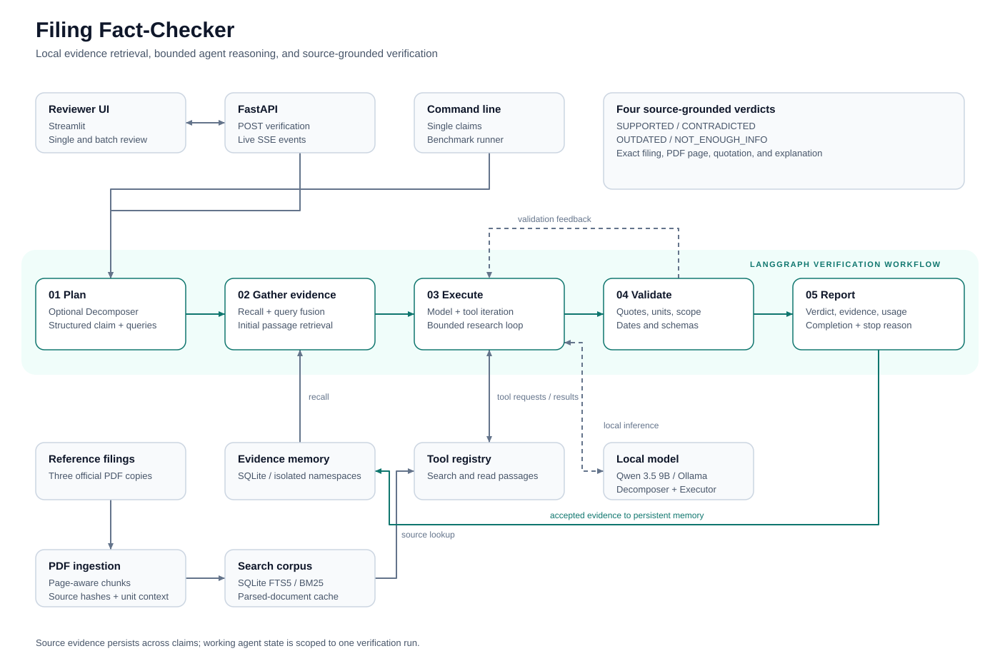

# Filing Fact-Checker

Evidence-grounded verification of company statements against official CrowdStrike
filings. Each result includes a verdict, exact source quotations, PDF page numbers,
an explanation, and model/tool usage.

**Stack:** Python · LangGraph · FastAPI · Streamlit · SQLite FTS5 · Ollama / Qwen 3.5 9B

## Features

- Four verdicts: `SUPPORTED`, `CONTRADICTED`, `OUTDATED`, and `NOT_ENOUGH_INFO`.
- A Decomposer and an iterative Executor coordinated through LangGraph.
- Search across all three filings, query fusion, and full-passage retrieval.
- Persistent evidence memory with source fingerprints and filing provenance.
- Exact-quote validation, financial unit checks, temporal checks, and call budgets.
- Live server-sent events, single-statement review, batch review, and report downloads.

## Quick start

Requires Python 3.11+ and a running local Ollama service. The three reference PDFs
are included under `data/raw/`; their official URLs are recorded in `data/filings.json`.

```sh
git clone https://github.com/cyash24f3/fillingfactz.git
cd fillingfactz
python3 -m venv .venv
source .venv/bin/activate
python -m pip install -e .
ollama pull qwen3.5:9b
python -m filing_checker.prepare
```

For the pinned Python 3.12 reference environment, use
`python -m pip install -r requirements-lock.txt` in place of the editable-install command.

Start the API and reviewer UI in separate activated terminals:

```sh
python -m uvicorn filing_checker.api:app --host 127.0.0.1 --port 8000
```

```sh
python -m streamlit run streamlit_app.py
```

Open **http://localhost:8501** for the UI or **http://127.0.0.1:8000/docs** for the
interactive API. Verification runs locally without an API key.

## Architecture

[Editable Excalidraw system design](docs/architecture/README.md): nine self-contained
sections covering the complete workflow, agents, memory, evidence checks, interfaces,
contracts, evaluation and deployment.



The workflow plans the research, recalls relevant evidence, searches the supplied
filings, and iterates until a validated verdict is submitted or a budget is reached.
Accepted source evidence is retained for related statements.

See [Architecture](docs/ARCHITECTURE.md) for the workflow, state, and module map,
and [Design decisions](docs/DESIGN.md) for the MERMAID adaptation and validation rules.

## Usage

```sh
python main.py "CrowdStrike's fiscal year ends on January 31." --trace
```

CLI options include `--no-memory`, `--no-decomposer`, `--memory-namespace`,
`--max-model-calls`, and `--max-tool-calls`.

| Endpoint | Purpose |
|---|---|
| `GET /health` | API status and configured model |
| `POST /verify` | Structured verification report |
| `POST /verify/stream` | Live steps and final report over SSE |

## Tests and benchmark

```sh
python -m unittest discover -s tests -v
python -m filing_checker.evaluate --validate-only
python -m filing_checker.evaluate --mode all
```

The benchmark contains **20 labelled statements evaluated in three configurations:
60 verification runs**. Configurations compare the full workflow, memory disabled,
and Decomposer disabled. Results include predictions, accuracy, calls, tokens, and
elapsed time.

[The complete benchmark](results/benchmark/summary.md) records **60/60 correct,
complete runs** on the included development dataset.

| Configuration | Accuracy | Completed | Model calls | Tool calls | Tokens | Seconds | Memory reads/writes |
|---|---:|---:|---:|---:|---:|---:|---:|
| Full | 100% | 20/20 | 54 | 74 | 191,196 | 839.5 | 20/18 |
| Memory disabled | 100% | 20/20 | 58 | 78 | 192,919 | 963.1 | 0/0 |
| Decomposer disabled | 100% | 20/20 | 35 | 54 | 158,559 | 772.2 | 20/18 |

Against the [original baseline](results/baseline/summary.md), the full workflow
improved from 85% to 100% accuracy while using
28.2% fewer tokens,
11.5% fewer model calls,
and 17.5% less elapsed time.
These are measured local results for the recorded snapshots.

The project also passes **92 automated tests** and **12 additional live API checks**.
See [Validation](docs/VALIDATION.md) and [Evaluation](docs/EVALUATION.md) for evidence,
protocol, ablations, and practical limits. The benchmark environment is Apple M5,
24 GiB RAM, Python 3.12, and local Qwen through Ollama.

## Project guide

- [Submission overview](SUBMISSION.md)
- [Architecture and module map](docs/ARCHITECTURE.md)
- [Design decisions and MERMAID adaptation](docs/DESIGN.md)
- [Evaluation protocol and results](docs/EVALUATION.md)
- [Labelled statements and source references](data/test_statements.json)
- [Requirements checklist](docs/REQUIREMENTS.md)
- [Interface and automated validation](docs/VALIDATION.md)
- [Saved diagnostic predictions](results/diagnostic/full/predictions.json)

PDF page numbers refer to the included PDF copies. Keyword retrieval and table
extraction have practical limits; validation establishes provenance and selected
consistency checks, while semantic judgments remain model-dependent.
