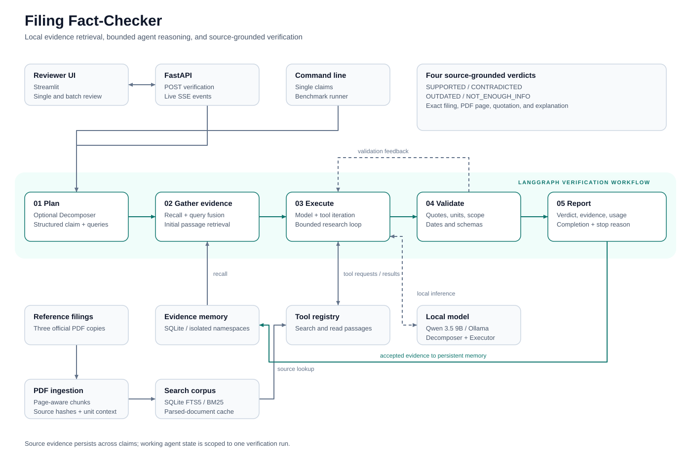
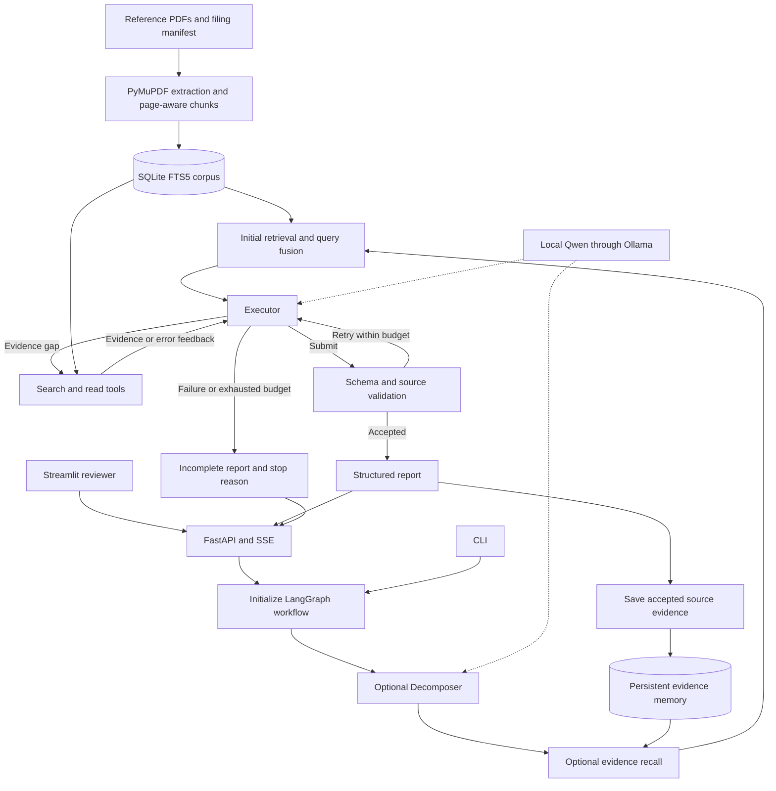

# Architecture

## Verification workflow

## State and persistence

The outer LangGraph runs initialize → decompose → recall → verify → remember.
The Executor is a nested graph with bootstrap, model, and tools nodes. Its state
holds the statement, messages, pending calls, searched filings, loaded passage IDs,
usage counters, and trace events. Tool results and validation errors are appended
to the message history before the next model request. Search results retain each
complete passage once; repeated hits refer to its already-loaded ID rather than
appending the same text again. Explicit passage reads remain available.

Working state lasts for one invocation. SQLite evidence memory persists across
runs and is isolated by namespace. It stores source passages and quotations rather
than previous verdicts. Recall verifies current source fingerprints before reuse.
Fresh retrieval covers all supplied filings, including newer disclosures.

Corpus preparation uses PDF fingerprints and parsed-document caches. Each passage
retains filing metadata, a PDF page number, the source hash, and page context for
table units. Final quotations are recovered from the original passage text.

## Module map

| Module | Responsibility |
|---|---|
| `ingestion.py`, `documents.py` | Manifest loading, PDF parsing, chunking, and index preparation |
| `retrieval.py`, `context_views.py` | SQLite search, passage reads, and compact model context |
| `tools.py` | Validated tool registry and query fusion |
| `decomposer.py` | Structured claim plan and search cues |
| `agent.py`, `graph.py` | Executor loop and outer LangGraph workflow |
| `evidence.py`, `periods.py`, `models.py` | Schemas, quote matching, period binding, and consistency checks |
| `memory.py` | Persistent evidence recall and storage |
| `llm.py` | Local Ollama client and usage measurement |
| `service.py`, `api.py` | Async verification and streamed API events |
| `ui_client.py`, `streamlit_app.py` | Reviewer interface and stream consumption |
| `evaluate.py`, `api_evaluate.py` | Benchmark comparison, additional live API checks, and saved reports |

The API serializes verification within one process for the local model. Separate
CLI processes operate independently. The application does not checkpoint or resume
an interrupted LangGraph invocation.
