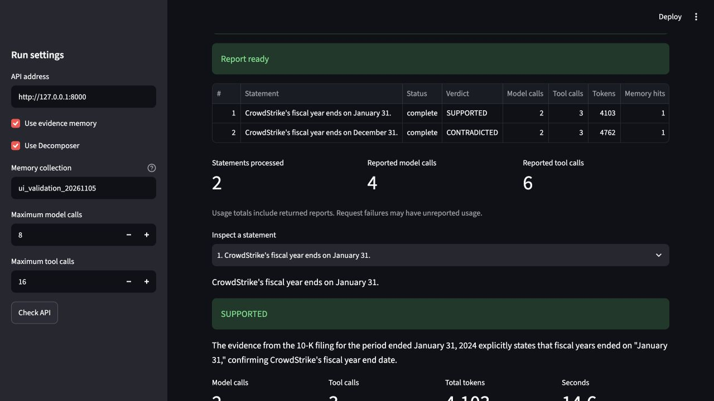
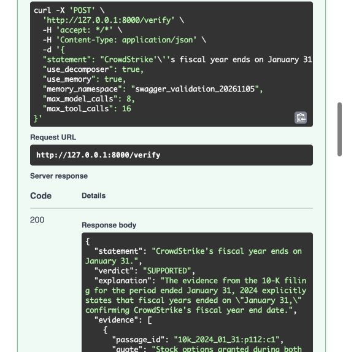

# Validation

The reference environment installs from `requirements-lock.txt` in a fresh virtual
environment. A clean checkout of `d6a7e14` passed all **92 automated tests** and
validated all twenty labelled statements and their seventeen shared references.
GitHub Actions repeats these checks on Python 3.12 without requiring Ollama.

```sh
python -m unittest discover -s tests -v
python -m filing_checker.evaluate --validate-only
```

Coverage includes malformed submissions, tool and model failures, call budgets,
repeated searches, source quotations, stale memory, namespace isolation, numeric
units, rounding, comparative year/date columns, period coverage, PDF page
navigation, HTTP contracts, SSE transport, and the Streamlit application.

## Live interfaces

The running local service was exercised through `POST /verify` in Swagger UI,
returning HTTP 200 with a complete source-backed report. `GET /docs`,
`GET /openapi.json`, and `GET /health` returned HTTP 200. Opening `/verify` in an
address bar sends GET; this endpoint correctly requires POST.

Streamlit single-statement and batch reviews completed successfully. The batch
produced SUPPORTED and CONTRADICTED reports for the two fiscal-date statements;
the downloaded JSON contained both validated reports, settings, and event trails.





## Additional model checks

The [live API validation](../results/api_validation/README.md) records **12/12**
complete, matching verdicts with completed SSE streams. Cases cover metric
confusion, paraphrases, thousand/million/billion scaling, current versus historical
balances, missing regional counts, forecasts, missing annual actuals, comparative
fiscal years, and comparative balance-sheet dates.

The separate [benchmark](../results/benchmark/summary.md) compares all twenty
labelled claims under three configurations. Its recorded source hashes identify
the exact implementation evaluated. An incomplete fallback is always scored as
incorrect, even if its label matches the expected answer.
