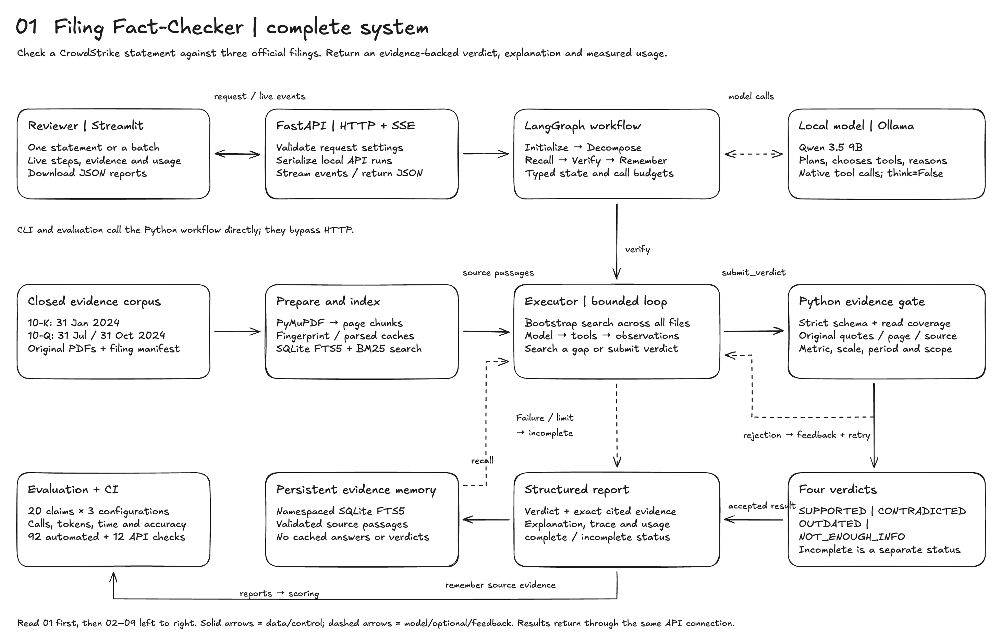

# Excalidraw system design

A self-contained, black-and-white architecture board for the implemented Filing
Fact-Checker. The drawing uses Excalidraw's default Excalifont handwriting font,
default black strokes and text, a white canvas, and editable native shapes.
It contains **nine named frames and 348 editable elements**.

## Open and present

1. Open [Excalidraw](https://excalidraw.com/).
2. Use **Open**, or drag `system-design.excalidraw` onto the canvas.
3. Start with frame **01** for the complete overview. Move through frames **02–09**
   for details. Selecting a frame and choosing **Zoom to selection** makes it easier
   to present one section at a time.
4. `overview.excalidraw` contains just the overview when a smaller starting canvas
   is preferable.

The native files can be edited freely; they are not flattened screenshots. The
complete board is also available as [SVG](system-design.svg). Each section has a
standalone, font-embedded SVG and a high-resolution PNG for convenient viewing
or insertion into presentation material. These exports do not need the application
server or Ollama to be running.

## Sections

| Frame | Covers | Preview | Vector |
|---|---|---|---|
| 01 | Complete system, primary flows, result paths and legend | [PNG](section-01.png) | [SVG](section-01.svg) |
| 02 | Official PDFs, manifest, fingerprints, parsing, chunks, provenance, SQLite and rank fusion | [PNG](section-02.png) | [SVG](section-02.svg) |
| 03 | Outer LangGraph, typed Decomposer plan, nested Executor, tool selection, retries and budgets | [PNG](section-03.png) | [SVG](section-03.svg) |
| 04 | Per-run state, message accumulation, persistent evidence memory, cache lifetimes and recall rules | [PNG](section-04.png) | [SVG](section-04.svg) |
| 05 | Candidate validation, exact quotations, metric/period/scale/scope checks, verdict definitions and incomplete status | [PNG](section-05.png) | [SVG](section-05.svg) |
| 06 | FastAPI routes, Swagger, SSE sequence, reviewer features, batch flow, input validation and concurrency | [PNG](section-06.png) | [SVG](section-06.svg) |
| 07 | Request/result/evidence contracts, extensible tool registry and a complete stale-cash example | [PNG](section-07.png) | [SVG](section-07.svg) |
| 08 | Dataset, three configurations, scoring, native measurements, efficiency changes and verification | [PNG](section-08.png) | [SVG](section-08.svg) |
| 09 | Local processes/ports, storage, module responsibilities, MERMAID adaptation and current boundaries | [PNG](section-09.png) | [SVG](section-09.svg) |

## Reading the architecture accurately

Solid arrows carry data or control; dashed arrows identify model/optional/feedback
relationships as labelled. The overview summarizes the workflow; the detailed
frames explain exact implementation responsibilities. CLI and benchmark execution
use the Python service directly, while Streamlit uses HTTP. Batch verification is
implemented by the UI client as sequential single-statement requests.

Working state lasts for one invocation. The evidence store persists across runs
and caches authenticated source passages rather than verdicts. Fresh retrieval
still searches all supplied filings. Numerical checks apply to supported formats;
the model remains responsible for broader semantic interpretation. An incomplete
result is an operational failure state, not a fifth verdict or a successful NEI.

## Implementation and measurements

The diagram describes application source from commit `794abfb`; the measured
benchmark's engine hashes correspond to `d6a7e14`, with only documentation/result
changes between those snapshots. Metrics are copied from
[`results/benchmark/summary.json`](../../results/benchmark/summary.json).
The twenty development statements are evaluated under three configurations, giving
sixty runs; they are not sixty unique claims or a held-out generalization test.

The native scene was generated and rendered with the official Excalidraw 0.18.1
engine, visually checked section by section, and reopened successfully through
Excalidraw's native scene loader. Text-fit checks found no overflowing cards or
frames. `layout-check.json` records the element/frame counts and font family.

